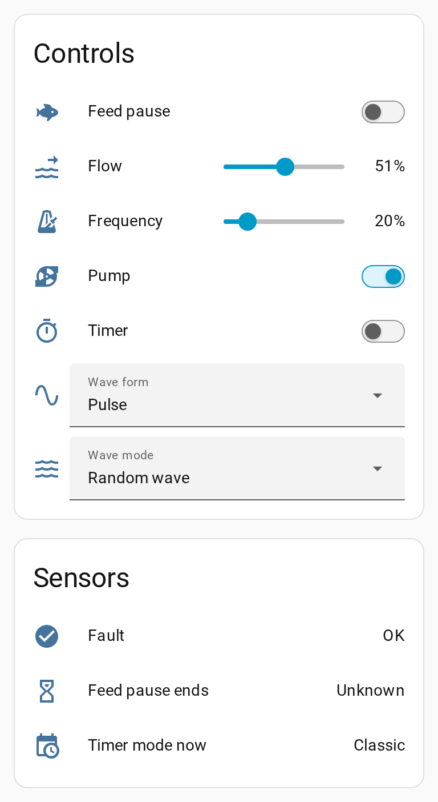
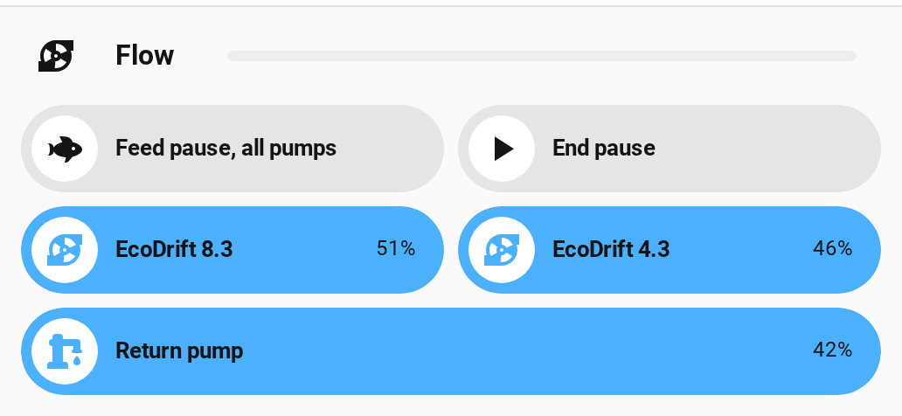

<h1> Aqua Medic Local (unofficial)</h1>

[](https://hacs.xyz)
[](https://github.com/patrickk88/aquamedic-local/releases)
[](https://www.home-assistant.io)
[](https://github.com/patrickk88/aquamedic-local/actions/workflows/validate.yml)
[](https://github.com/patrickk88/aquamedic-local/blob/main/LICENSE)

**Local control of Aqua Medic app-controlled pumps in Home Assistant - no cloud, no account.**

> **Unofficial community project. Not affiliated with, endorsed by or supported by Aqua Medic.**
> "Aqua Medic", "EcoDrift", "SmartDrift" and "DC Runner" are the manufacturer's product names and
> are used only to describe which devices this integration works with.

The Wi-Fi module in these pumps runs Gizwits firmware. Besides the cloud the official app uses,
it speaks a small LAN protocol (UDP 12414 for discovery, TCP 12416 for control) - the same one
the app uses when your phone is at home. This integration talks to that port only. The app and
the pump's own cloud connection keep working; several clients can be logged in at once.

<p align="center">
  
  
</p>
<p align="center"><sub>An EcoDrift 8.3 as a device in Home Assistant, and the flow section of my own aquarium dashboard (the return pump there comes from <a href="https://github.com/patrickk88/reef-factory-local">Reef Factory Local</a>).</sub></p>

**Contents:** [Supported devices](#supported-devices) · [Installation](#installation) ·
[Use at your own risk](#use-at-your-own-risk) · [Entities](#entities) · [Guides](#guides) ·
[Questions](#questions) · [When something does not work](#when-something-does-not-work) ·
[Development](#development)

## Supported devices

| Device | Read | Control | Tested |
|---|---|---|---|
| **EcoDrift x.3 / SmartDrift x.1** | yes | yes - every control was confirmed on a real pump | EcoDrift 4.3 and 8.3, Wi-Fi module 04020B25 |
| **DC Runner x.3** (return / skimmer pump) | yes | no - read only | untested, testers welcome |

<details>
<summary><b>EcoDrift x.3 / SmartDrift x.1</b> (Gizwits product <code>63632f49…</code>)</summary>

- **Read:** on/off, wave mode, wave form, flow, frequency, feed pause and its duration, timer on/off, current timer mode with its flow/frequency, timer slots, linkage, seven fault flags.
- **Control:** pump on/off, wave mode (classic / sine / random / constant), wave form (pulse / cross-flow), flow %, frequency %, feed pause, feed pause duration, timer on/off, linkage.
- **Tested:** module 04020B25 (EcoDrift 4.3 and 8.3); **every control listed here was confirmed on a real pump** (see below).
- Writing timer slots (the 48-slot schedule) is not offered yet; the slots are shown as attributes
of the *Timer* switch and the *Timer slots* sensor.

</details>

<details>
<summary><b>DC Runner x.3</b> return / skimmer pump (<code>00276aa0…</code>) - read only, untested</summary>

- **Read:** on/off, control mode, speed, feed pause and its duration, timer, current timer mode, timer slots, pump clock, fault flags.
- **Control:** none. It is decoded from the public datapoint schema; no write is sent until a DC Runner
  owner confirms it. Its switches and numbers appear as read-only sensors.
- If you own one and want to help, open an issue - see [Questions](#questions).

</details>

<details>
<summary><b>Only confirmed writes are sent</b> - what was tested, and when</summary>

Each EcoDrift control above was switched on a real EcoDrift 8.3
(Wi-Fi module 04020B25) through this integration and back, and counted as confirmed only when the pump
reported the new value in its own status: pump on/off, flow, frequency, feed pause, feed pause duration
(04.-05.11.2026), wave mode, wave form, timer on/off and linkage (05.11.2026); linked operation - synchronous
and cross-flow - on an EcoDrift 8.3 (master) with a 4.3 (slave), 05.11.2026. The DC Runner has no
write path at all; its switches and numbers appear as read-only sensors. If you own one and want to help,
open an issue.

</details>

## Installation

Needs Home Assistant 2025.1 or newer.

**1. Find *Aqua Medic Local* in HACS** (from Home Assistant 2026.11 on it is called *Marketplace*),
download it and restart Home Assistant:

[](https://my.home-assistant.io/redirect/hacs_repository/?owner=patrickk88&repository=aquamedic-local&category=integration)

**2. Add the integration** and pick your pump - the pumps on your network are listed:

[](https://my.home-assistant.io/redirect/config_flow_start/?domain=aquamedic_local)

The passcode the pump needs for login is fetched from the pump itself - no app account, no cloud.

<details>
<summary>Without the buttons, or without HACS / Marketplace</summary>

The first button opens this integration in HACS - or in the Marketplace, as HACS is called from Home
Assistant 2026.11 on - in your own Home Assistant. Without the button: open HACS or the Marketplace and
search for *Aqua Medic Local* (it is in the default list). Or copy `custom_components/aquamedic_local`
into your Home Assistant `config/custom_components/` and restart.

Then *Settings -> Devices & services -> Add integration -> Aqua Medic Local*.

If you added it as a *custom repository* before it was in the HACS default list, you can remove that
entry (HACS -> menu -> *Custom repositories*); the installed integration stays.

</details>

<details>
<summary>The pump is not listed, or it refuses its passcode</summary>

If no pump is found (different subnet, broadcast blocked), enter the IP address of the pump's Wi-Fi
module.

If the pump refuses to hand out its passcode ("not in binding mode"), power-cycle it or press its
Wi-Fi button briefly and try again within a few minutes. Once stored, the passcode stays valid.

</details>

<details>
<summary>More pumps, and a pump that got a new IP address</summary>

Once one pump is set up, the integration searches the network every 10 minutes (and when a pump
goes offline): further pumps appear under *Discovered*, and a known pump that got a new IP address is
found again and its entry updated automatically. A fixed address in the router is still a good idea.
To change the address by hand: entry -> menu -> *Reconfigure*.

</details>

The interface is available in English, German, Dutch, French, Spanish, Italian and Polish.

## Use at your own risk

This software is provided "as is", without warranty of any kind (see the MIT license). It controls
pumps that keep a tank alive. A bug, a wrong automation or a lost network connection can stop the
flow or run a pump dry. **You alone are responsible for your tank.** Watch the tank after installing
or updating, keep the pumps' own settings sensible, and do not let automations switch pumps off
without a limit you have checked. I am not liable for any damage to equipment, livestock
or property.

The protocol was taken from what the pumps send on the network and from the publicly readable
datapoint schema of each product; no firmware was decompiled and no manufacturer files or keys are
included. Using it may void your warranty.

## Entities

- **Pump** (switch) - on/off.
- **Wave mode** (select) - classic, sine, random wave, constant.
- **Wave form** (select) - pulse or cross-flow (state `tide`, used by the classic mode; see *Linking two pumps*).
- **Flow**, **Frequency** (number, %) - the current manual setting.
- **Feed pause** (switch) with **Feed pause duration** (number, 1-60 min) and **Feed pause ends**
  (timestamp, calculated when the pause starts).
- **Timer** (switch) - run the pump's own 48-slot schedule instead of the manual setting; attributes
  show the slots. **Timer mode now** (sensor) shows what the schedule is doing right now.
- **Linkage** (select) - independent, master or slave (the pumps' own 2.4 GHz coupling).
- **Fault** (binary sensor) - any of: motor overcurrent, overvoltage, overtemperature, undervoltage,
  locked rotor, no load (dry run), module link. The seven flags are also available as individual
  diagnostic binary sensors (disabled by default).

State values are keys (`random`, `tide`, `independent` ...); the UI translates them.

## Guides

<details>
<summary><b>Linking two pumps (master / slave)</b></summary>

Tested with an EcoDrift 8.3 as master and a 4.3 as slave:

- Set *Linkage* to **master** on one pump and to **slave** on the others - only one master per tank. The
  pumps couple by themselves; Home Assistant only sets the role. The pump displays show Master / Slave.
- **Synchronous:** the slaves run the master's program at the same time. Change wave mode, wave form and
  frequency on the master only; a slave takes them over within seconds and reports them. Flow stays per pump.
- **Alternating (cross-flow):** on the master set *Wave mode* to **classic** and *Wave form* to
  **cross-flow**; the pumps then take turns. The master's *Frequency* sets how long a turn lasts - a low
  value means short turns (at 5 % they clearly alternated within two minutes, at 100 % no change was
  visible within six minutes). It can take up to three turns until the pumps find their rhythm. The pumps
  do not report which one is running, so Home Assistant cannot show the current turn.
- To undo, set every pump back to **independent**.

</details>

<details>
<summary><b>Feed pause without stopping the pump</b></summary>

The pump's own *Feed pause* stops it completely. In a tank with curious animals that can be a problem - here a
sea urchin used the pause to crawl into the pump's opening. An alternative is a feed pause at minimum flow:
switch the pump to **constant** at its lowest flow and put the previous values back afterwards. A script
(entity ids are examples):

```yaml
alias: Feed pause at minimum flow
mode: single
sequence:
  - variables:   # save first - with linked pumps save every pump before changing any
      mode: "{{ states('select.ecodrift_8_3_wave_mode') }}"
      flow: "{{ states('number.ecodrift_8_3_flow') | int }}"
  - action: select.select_option
    target: {entity_id: select.ecodrift_8_3_wave_mode}
    data: {option: constant}
  - wait_template: "{{ is_state('select.ecodrift_8_3_wave_mode', 'constant') }}"
    timeout: 15
  - action: number.set_value
    target: {entity_id: number.ecodrift_8_3_flow}
    data: {value: 30}
  - delay: "00:10:00"
  - action: number.set_value
    target: {entity_id: number.ecodrift_8_3_flow}
    data: {value: "{{ flow }}"}
  - wait_template: "{{ states('number.ecodrift_8_3_flow') | int == flow }}"
    timeout: 15
  - action: select.select_option
    target: {entity_id: select.ecodrift_8_3_wave_mode}
    data: {option: "{{ mode }}"}
```

- **One change at a time:** wait until the pump reports a value before sending the next one. A write that
  follows too quickly is built on the pump's previous status and can put the first change back.
- **Minimum flow:** the EcoDrift 4.3 and 8.3 (module 04020B25) run at least 30 % - 25 % came back as 30 %.
- **Linked pumps:** a slave follows the master's wave mode within seconds, so save the values of every pump
  first, then change them; the slave's flow stays its own.
- Start it a little before the feeder turns (e.g. a time trigger 30 s before the feeder's next feeding), so
  the food is not blown away.

</details>

<details>
<summary><b>Known quirks</b></summary>

- The pump pushes a status only when something changes, so the entities are "available" as long as
  the heartbeat is answered, even if no value changed for hours.
- Switching the **timer on** makes the pump take over flow and frequency of the current timer slot within
  a second; switching it **off again does not restore** the previous manual flow (pump behaviour, the app
  does the same). Set the flow again after turning the timer off.
- Anyone on your LAN can control the pump this way - the module hands out its passcode to whoever
  asks (manufacturer behaviour, same as the app). Keep IoT devices in a trusted network.
- Flow and frequency below the pump's own minimum are clamped by the pump.
- The schedule's "flow" byte holds the feed pause length in minutes when the slot mode is *feed*.
- Firmware 04020B25 ignores a write that changes *only* the flow; the integration therefore always
  sends the current frequency along with it (the app does the same from its screen).
- Changes are pushed by the pump as command `0x0093` carrying its device id (not `0x0091` as in other
  Gizwits devices); the integration decodes both, so changes made in the app show up immediately.

</details>

## Questions

<details>
<summary><b>Does the official Aqua Medic app keep working?</b></summary>

Yes. The integration only talks to the pump's local port. The app and the pump's own cloud connection
keep working, several clients can be logged in at once, and what you change in the app shows up in Home
Assistant right away.

</details>

<details>
<summary><b>Do I need the cloud or an app account?</b></summary>

Not for this integration. The pump only has to be on your Wi-Fi already; the passcode it needs for
login is fetched from the pump itself.

</details>

<details>
<summary><b>What happens when Home Assistant is down?</b></summary>

The pump keeps running with its last settings or its own schedule - Home Assistant only changes
settings, the pump does not need it to run. What stops is what your own automations do: a feed pause
script, for example, that has not put the flow back yet.

</details>

<details>
<summary><b>Can I break something with it?</b></summary>

The integration only sends what was confirmed on a real pump. But it does control pumps that keep a
tank alive - a wrong automation can stop the flow. See [Use at your own risk](#use-at-your-own-risk).

</details>

<details>
<summary><b>I have a DC Runner, or another Aqua Medic pump</b></summary>

A DC Runner can be added and is read only. Please open an issue and attach its diagnostics file (see
below) - it shows whether the decoding is right, and controls are added once an owner has confirmed
them on a real pump. For another app-controlled Aqua Medic pump open an issue with the model; how a
product is added is described under [Development](#development).

</details>

Something else? [Open an issue](https://github.com/patrickk88/aquamedic-local/issues).

## When something does not work

Look at *Known quirks* under [Guides](#guides) first. *Download diagnostics* (entry menu) gives a JSON
file with the decoded and raw status (passcode, MAC and device id removed) - please attach it to issues.

## Development

- `custom_components/aquamedic_local/protocol.py` - framing, the two datapoint schemas, decode/encode;
  no Home Assistant imports. `python3 tests/test_protocol.py` runs the tests with status blocks
  captured from real pumps.
- `client.py` - one TCP session per pump (passcode -> login -> read; heartbeat every 4 s, reconnect).
- Datapoint schemas of other Gizwits products can be fetched without an account:
  `https://euapi.gizwits.com/app/datapoint?product_key=<key>`. Adding a product means adding its
  attribute table to `protocol.py` and a decode mapping.

Protocol references: [jebao-doser](https://github.com/m0s4ik/jebao-doser) (Gizwits LAN client for
Jebao dosers), [node-ph803w](https://github.com/Apollon77/node-ph803w/blob/master/PROTOCOL.md)
(packet-level description), [ha-aquamedic-component](https://github.com/Elwinmage/ha-aquamedic-component)
(cloud-based alternative with the same datapoints).

## Related projects

- [Reef Factory Local](https://github.com/patrickk88/reef-factory-local) - my integration for Reef
  Factory aquarium devices (Level keeper, Thermo control, Reef Flare, Smart Roller, Smart feeder, Base
  pump, Dosing pump Pro X4), local and without the cloud.

## Support the project

This is a hobby project, free for everyone. If it saves you a cloud dependency, you can buy me a coffee.

[](https://buymeacoffee.com/patrical)

## License

MIT - see `LICENSE`. This repository contains only original code; the datapoint layout is the
product's public schema, re-expressed as a table.
